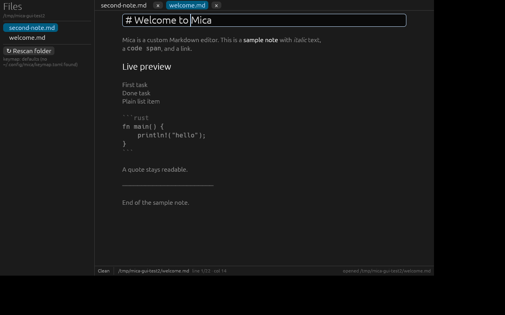

# mica-egui-poc — Mica PoC on egui + eframe

A working miniature of the Mica Markdown editor built with
[egui](https://github.com/emilk/egui) / `eframe`, on top of the
framework-independent `mica-shared-core` crate. All file model,
live-preview decoration, auto-save, keymap and fuzzy-match logic
comes from shared-core; this crate is only the egui wiring (panels,
widgets, keyboard dispatch).

## Versions pinned

| Item | Version | Source |
| --- | --- | --- |
| `eframe` | `=0.37.0` | crates.io, released 2026-10-15 |
| `egui` | `=0.37.0` | crates.io (same release) |
| Rust | 1.100.0 (VM toolchain at `~/.cargo/bin`) | MSRV of eframe 0.37 is ~1.95 |
| `mica-shared-core` | workspace path `poc/shared-core` | this repo |

## How to run

```sh
# From the workspace root:
cargo run -p mica-egui-poc -- sample-notes
cargo run -p mica-egui-poc -- /path/to/any/folder

# Headless smoke test (no display needed; works on a temp copy,
# the original folder is never modified):
cargo run -p mica-egui-poc -- --smoke-test sample-notes
# or with the built binary:
./target/debug/mica-egui --smoke-test sample-notes

# Open the GUI and quit automatically after N seconds
# (used by the xvfb verification below):
./target/debug/mica-egui sample-notes --quit-after 10
```

The folder argument defaults to `sample-notes` when it exists,
otherwise the current directory. No vault is created anywhere;
settings live only in `~/.config/mica/keymap.toml` (see below).

## What it does

- **File tree** (left panel): `shared-core` `scan_folder`, folders
  collapsible, Markdown files listed. Keyboard: `j`/`k` move,
  `l` opens the selected file (or toggles a folder), `h` collapses,
  `Ctrl+B` hides the tree. `Enter` is not bound in the tree: it only
  splits the line in the editor and runs the selection in the palette.
  A "Rescan folder" button re-reads the folder.
- **Tabs** (top bar): one file = one tab (`shared-core` `tabs`);
  reopening focuses the existing tab; `●` marks a dirty tab;
  `Ctrl+W` closes, `Ctrl+Tab` goes to the next tab.
- **Editor** (centre): live preview, see "Live-preview approach"
  below. Centred body column, max 720 px, proportional 16 pt body
  font, monospace only for code spans/blocks. Dark theme.
- **Status bar** (bottom): save state (`Clean` / `● Unsaved` /
  `Saving…` / `✓ Saved`), file path, cursor `line/col`, last action.
- **Auto-save**: `shared-core` `auto_save`, 1000 ms debounce,
  atomic write (temp file + rename), visible in the status bar.
  Every open document is saved when its debounce elapses, not only
  the active tab. Closing a tab saves unsaved edits first (if that
  save fails, the tab stays open and the status bar shows the
  error), and closing the window saves every dirty document.
- **Command palette** (`Ctrl+Shift+P`) and **Quick Open** (`Ctrl+P`):
  `shared-core` `command_palette` fuzzy matching over commands and
  file names; `↑`/`↓` + `Enter` to run/open, `Esc` to close.
- **Keymap**: one global file `~/.config/mica/keymap.toml`, loaded
  on start; falls back to the built-in defaults from Notion §7 when
  the file is missing or invalid. The tree footer shows which keymap
  is active. Area bindings win over global ones, so typing `j` in
  the editor inserts a `j` instead of moving the tree cursor
  (covered by a unit test).

## Live-preview approach (chosen design)

**Custom per-line widget — not a styled read view + raw `TextEdit`
swap.**

The document is rendered one line at a time inside a scroll area:

- every line *except* the cursor line is a read-only styled
  paragraph built from `shared-core` `decorate_line` segments as an
  `egui::text::LayoutJob` — heading sizes (H1 1.6×, H2 1.4×, …),
  bold spans, italic spans, monospace code, hidden markers;
- the cursor line is a raw single-line `egui::TextEdit` holding the
  line's Markdown, so its markers are visible and editable — exactly
  the row-level rule from the Notion child page;
- clicking a styled line (or `↑`/`↓`) makes it the cursor line:
  the styled paragraph is replaced by the raw `TextEdit`. `Enter`
  splits the line at the cursor; `Backspace` at column 0 merges it
  into the line above.

The buffer always holds raw Markdown; editing, saving and undo work
on plain text. Cursor-column tracking uses the `TextEdit` output's
`cursor_range` (char indices, so Japanese text is safe).

### Limits of this approach (honest)

- **No multi-line selection or cross-line copy/paste**: each line is
  its own widget, so selection lives inside one line only.
- **Pasting multi-line text into a line inserts only the first
  line** (a single-line `TextEdit` drops the rest).
- **Bold has no dedicated font weight** in egui's bundled fonts, so
  bold spans render in the strong text colour at body size rather
  than a true bold face. Headings (larger size), italics (sheared by
  epaint) and monospace code (real monospace face) do render styled.
- **No virtualization**: the whole document is laid out every frame.
  A 385-line note renders and scrolls fine under Xvfb (verified),
  but a multi-thousand-line file will be slower than a virtualized
  editor. That is a PoC limit, not a design goal.
- **Checkboxes render as plain text**: `- [ ] First task` shows as
  `First task` (markers hidden); there is no clickable checkbox
  widget yet.
- **Code-block interior lines** originally rendered blank because
  `shared-core`'s parser returned no spans for them (found from the
  xvfb screenshot, see below). `shared-core` now emits one code span
  per interior line, so the decoration itself is a monospace segment
  (regression test
  `shared_core_code_block_interior_is_one_monospace_segment`). The
  view's raw-line monospace fallback remains only for lines whose
  whole content is a hidden marker (e.g. a bare `# `).



## Japanese IME

- Editing goes through egui's `TextEdit`, whose IME path is winit
  (`ImeEvent::Preedit`/`Commit`/`DeleteSurrounding`); the candidate
  window position is reported to the platform by egui. The buffer
  layer (`shared-core` `TextBuffer`, char-based columns) is what this
  PoC can verify headlessly.
- **Scripted headless test** (`src/smoke_test.rs`,
  `simulate_ime_composition`): feeds composition-like input through
  the buffer + decoration path — preedit insert of `こんにちは`,
  Backspace during composition (must delete exactly one char), commit
  of `こんにちは、世界` — and asserts the buffer is uncorrupted and
  the decoration mapping round-trips the committed text. Covered by
  unit tests and by the `--smoke-test` CLI mode.
- **Known open egui CJK bugs (not fixed here, recorded as
  untested-on-Windows items):**
  - [#7908](https://github.com/emilk/egui/issues/7908) — Backspace
    deletes characters in `TextEdit` during IME composition (CJK);
    reported to persist in recent versions; root cause points at
    winit not marking the confirming key as consumed on Windows.
  - [#7485](https://github.com/emilk/egui/issues/7485) — incorrect
    typing with IBus/Wayland enabled (only one character before
    refocusing, on Fedora/KDE/Wayland).
- **NOT verified, do not claim otherwise:** real Japanese IME input
  on Windows (MS IME / Google Japanese Input), candidate-window
  placement, Backspace-during-composition in a live window, and
  IBus/Fcitx5 behaviour on Linux/Wayland. The VM has no IME and no
  Windows. What *was* verified is the buffer/decoration path
  (above) plus Japanese glyph rendering: the line
  `これは日本語の行です。こんにちは、世界。` renders correctly in
  the xvfb screenshot via the installed Noto Sans CJK JP system font
  (eframe 0.37 `system_fonts` feature).

## What was verified on this Linux VM

All commands run from the workspace root
(`~/workspace/mica-poc`), Rust 1.100.0, 2026-11-15.

### Unit tests + headless smoke test — PASS

```sh
cargo fmt -p mica-egui-poc
cargo test -p mica-egui-poc
# 13 passed; 0 failed; 0 warnings
```

```sh
./target/debug/mica-egui --smoke-test sample-notes
# PASS: scan_folder finds markdown files — 2 markdown file(s)
# PASS: one file = one tab — open twice -> tab 0 then 0, 1 tab(s)
# PASS: japanese ime composition simulation — preedit insert +
#       backspace-during-composition (1 char) + commit こんにちは、世界,
#       decoration round-trip OK
# PASS: live preview hides heading marker off cursor line
# PASS: auto-save writes atomically — state after save: Saved
# PASS: re-read saved file from disk — disk content equals buffer content
# PASS: no temp file left behind — folder is clean
# PASS: buffer keeps original content plus edit — 7 line(s) after edit
# smoke test: 8/8 checks passed
# SMOKE TEST: PASS   (exit code 0)
```

The smoke test runs on a temporary copy of the folder; the original
`sample-notes/` is never modified.

### GUI under Xvfb — PASS (with two failures found and fixed)

```sh
xvfb-run -a ./target/debug/mica-egui sample-notes --quit-after 12
# equivalent manual run used for screenshots:
#   Xvfb :98 -screen 0 1280x800x24
#   DISPLAY=:98 ./target/debug/mica-egui /tmp/mica-gui-test --quit-after 60
```

- Window opens (1100×700, dark theme, tree + tabs + editor +
  status bar all render; screenshots in `/tmp` during verification,
  `screenshot-welcome.png` kept in this directory).
- **Failure 1 — missing runtime lib:** first run panicked in
  `xkbcommon-dl` (`Library libxkbcommon-x11.so could not be
  loaded`, exit 101). Fixed by installing `libxkbcommon-x11-0`
  (see apt list below). This is a *runtime* dependency winit needs
  on X11; the eframe README's build list does not mention it.
- **Failure 2 — `--quit-after` never fired:** `ui()` is only called
  on repaint, and an idle window never repaints, so the quit check
  never ran (`ViewportCommand::Close` was also unreliable from
  inside `ui()`). Fixed by requesting a repaint every frame while
  the quit timer is armed and exiting the process directly when it
  fires (test-only hook). Verified: later runs exit 0 on their own.
- **Failure 3 — code-block lines rendered blank:** see
  "Live-preview approach" above; fixed at the time with a view-side
  monospace fallback and re-verified by screenshot (since then fixed
  in `shared-core` itself; not re-screenshotted after that change).
- **Failure 4 — centred text:** the first screenshot showed every
  line centre-aligned. Fixed with a centred 720 px column
  (`allocate_ui_with_layout`) holding left-aligned text; re-verified.
- **Failure 5 — synthetic input without a window manager:**
  `xdotool windowactivate` fails under bare Xvfb ("windowmanager
  claims not to support _NET_ACTIVE_WINDOW"); keystrokes went
  nowhere. Fixed by using `xdotool windowfocus` (direct X focus).
  Not an app bug; recorded so the next person doesn't repeat it.

### Interactive GUI checks (xdotool + screenshots) — PASS

All on copies of `sample-notes` under `/tmp` (never the repo):

| Check | Result |
| --- | --- |
| Window appears (cold start, software rendering) | ~2.1 s from process start to mapped window (`xdotool search`) |
| Type ` GUI-TYPED` into the focused line editor | Text appears in the cursor line; tab shows `●`; status bar `● Unsaved`, `line 1/7 · col 24` |
| Auto-save after typing stops | Status bar `✓ Saved` + `saved …/second-note.md`; file on disk contains `# Second note GUI-TYPED` (verified with `head`) |
| `Ctrl+P` Quick Open | Overlay lists both files; typing `wel` + `Enter` opens `welcome.md` in a second tab |
| `Ctrl+Shift+P` Command Palette | Overlay lists all known commands (`quick_open`, `command_palette`, `toggle_file_tree`, `tab_recent_next`, `tab_close`, `search_in_folder`, `cursor_down/up`, `expand_or_open`, `collapse`, `new_file`, `rename`, …) |
| `Esc`, `Esc`, `j` | Palette closes, focus moves to the tree, `j` moves the tree selection from `second-note.md` to `welcome.md` |
| 385-line document (`/tmp/mica-long/long-note.md`) | Renders, scrolls (scrollbar visible), Japanese line renders correctly, headings/bold/italic/code all styled |
| `--quit-after` exit | Process exits 0 by itself (verified twice) |

Log noise (harmless): `libEGL warning: DRI3 error: Could not get
DRI3 device` — Xvfb has no DRI3; wgpu falls back to software
rendering (llvmpipe via `mesa-vulkan-drivers`).

### Build / startup timings (measured on this VM, 1.5 shared CPUs)

| Measurement | Value |
| --- | --- |
| First `cargo build -p mica-egui-poc` (all deps, debug) | 4 min 36 s wall |
| Incremental rebuild after a source edit | ~8–18 s |
| `cargo test -p mica-egui-poc` (13 tests) | ~0.07 s test time |
| Cold start to mapped window under Xvfb | ~2.1 s |
| Debug binary `target/debug/mica-egui` | 432 MB (debug symbols; release size not measured) |

### System packages (Debian/Ubuntu)

Already present on the VM: `libxcb-render0-dev`,
`libxcb-shm0-dev`, `libxcb1-dev`, `libxkbcommon-dev`,
`libwayland-dev`, `libgl-dev`, `libssl-dev`, `libvulkan1`, `xvfb`.

Installed for this PoC (as root, `apt-get install -y`):

```sh
# Build + runtime deps for eframe/wgpu on X11:
apt-get install -y libxcb-shape0-dev libxcb-xfixes0-dev \
  libvulkan-dev mesa-vulkan-drivers \
  libxkbcommon-x11-0 libxkbcommon-x11-dev
```

```sh
# Test-only tools (screenshots, synthetic input — NOT needed to
# build or run the app):
apt-get install -y x11-apps imagemagick xdotool
```

## Limits / not done

- **Windows visual check not done.** No Windows machine is
  available here; the GUI was verified only under Xvfb on Linux.
  Windows IME (MS IME / Google Japanese Input), candidate-window
  placement, and the egui issues #7908 / #7485 are untested — see
  "Japanese IME" above.
- **No real IME test.** Only the scripted buffer-level simulation.
- `new_file` / `rename` / `search_in_folder` commands exist in the
  palette but report "not implemented in this PoC".
- `open_folder` is CLI-only in this PoC (pass a folder argument);
  there is no in-app folder picker.
- Multi-line selection, multi-line paste, checkbox widgets,
  virtualization for very large files: not implemented (see
  "Live-preview approach").
- No release build or release binary size measured.
- `cargo test -p mica-shared-core` passes (25 + 1 tests) — shared-core
  was not modified by this PoC, but the suite was re-run as a sanity
  check.

## License

MIT OR Apache-2.0 (see `Cargo.toml`). egui / eframe / epaint are
MIT OR Apache-2.0. No GPL code anywhere in this PoC; nothing from
Zed's GPL editor crates is used or copied. `shared-core` is
MIT OR Apache-2.0 as well.
